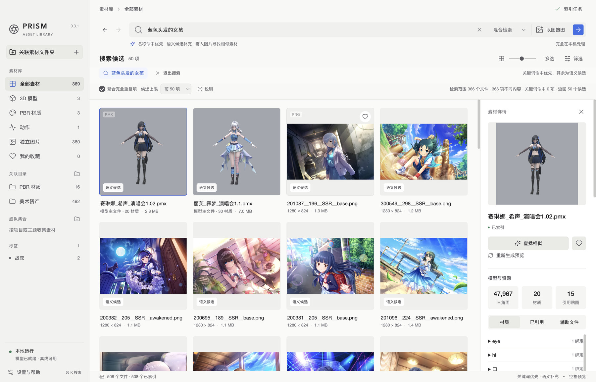
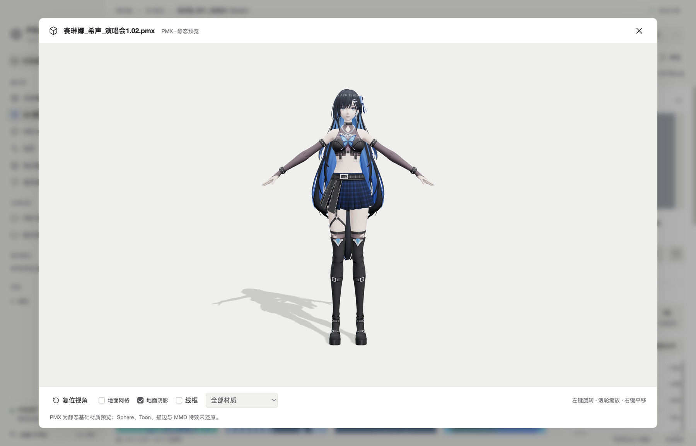
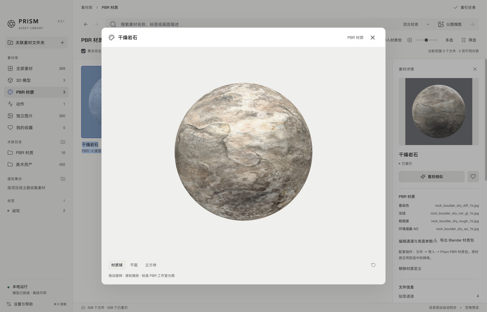
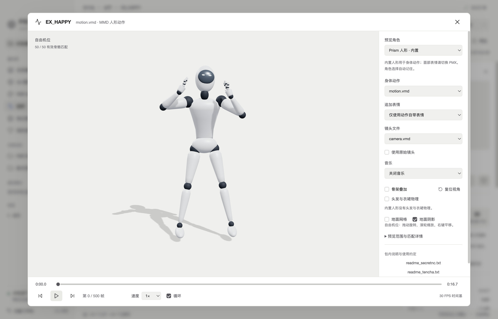

# Prism Assets · 棱镜素材库

面向美术创作者的 **本地多模态资产检索与管理工具**。用自然语言或参考图片寻找素材，在同一工作台预览图片、3D 模型、PBR 材质和人形动作，并通过标签、收藏与集合组织资产。

例如，输入“蓝色头发、穿黑色衣服的女孩”，可以跨图片和模型查看语义候选；已知角色名或材质名称时，也可以通过关键词快速定位。

Prism 基于 **EmbeddingGemma 2** 实现图文语义检索，模型推理与索引在本机完成。应用关联已有素材目录，保留原文件的位置与内容。

[界面预览](#界面预览) · [核心功能](#核心功能) · [安装运行](#安装运行) · [使用流程](#使用流程) · [开发](#开发)

## 界面预览



<details>
<summary>查看 3D 模型、PBR 材质与动作预览</summary>

### 3D 模型



### PBR 材质



### 人形动作



</details>

截图展示实际应用界面。示例图片、角色模型和动作的版权归各自作者；应用不附带这些素材。

## 核心功能

| 功能 | 说明 |
| --- | --- |
| 图文检索 | 自然语言描述、以图搜图、库内相似素材查找 |
| 混合检索 | 文件名、标签、目录、集合和模型名称匹配优先，视觉语义候选补充 |
| 3D 模型 | PMX、FBX、GLB、glTF 资产分组；交互旋转、缩放、平移、线框和材质隔离 |
| PBR 材质 | 导入贴图包、识别与编辑通道、实时预览、独立材质资产检索、Blender 材质包导出 |
| 人形动作 | VMD 动作包整理，内置人形或 PMX 角色播放，逐帧、循环、变速及骨架叠加 |
| 标签建议 | 本地分析类别、画风、光照和主色；可采纳、忽略、批量处理及配置词表 |
| 素材整理 | 手动标签、收藏、多级虚拟集合、批量操作、完全重复文件聚合 |
| 目录管理 | 多目录关联、子目录排除、文件变化增量同步、失联文件恢复及索引重试 |
| 工作台 | 浅色／深色／跟随系统、自定义主题色、透明网格、浏览前进与返回 |

### 检索：名称与视觉语义结合

- **关键词**：查找文件名、目录、标签、所属模型和集合名称，不调用嵌入模型。
- **语义**：用文字或参考图描述外观，在图文共享向量空间中计算相似度。
- **混合**：优先展示名称等元数据命中，同强度命中按语义排序，再补充语义候选。没有关键词命中时使用语义排序。

目录、集合、类型和标签等筛选先限定检索范围，再排序。候选数量可选 20／50／100／200，默认 50。

图片直接编码；3D 模型由 Blender 渲染两个视角后编码，材质由材质球封面编码。VMD 动作通过名称、目录和标签检索，点击后在播放器查看实际运动。

### 整理：模型、贴图与动作按资产组织

模型主文件和关联贴图归入同一资产组，材质绑定贴图归入所属材质，避免附属文件淹没普通图片列表。VMD 身体、表情、镜头文件按目录组成动作包。

虚拟集合可以按项目、角色或场景建立层级；同一素材可加入多个集合。标签、收藏、集合和排除规则保存在应用索引中，不移动原始文件。

### 本地标签建议

复用已有图像向量，与标签描述的文本向量比较，生成类别、画风和光照建议；从缩略图像素提取主色。已有标注样例可用于构建标签原型，帮助识别项目或角色相关标签。

默认启用类别和主色，分组、描述与阈值可在「设置与帮助 → 自动标签」调整。建议只有在用户采纳后才成为正式标签，也支持批量采纳和忽略。

## 安装运行

### 环境

- **Apple Silicon Mac**，macOS 14+
- **Python 3.11**
- **Node.js 20+** 与 npm
- **Blender**：模型转换、模型封面和材质封面需要；默认从 `/Applications/Blender.app` 检测

嵌入模型使用 MLX / Metal，运行文字与图片编码。无需云端 API Key；首次安装依赖和下载权重需要联网，之后模型推理使用本地文件。

### 从源码运行

```bash
git clone https://github.com/aukmiriaP/prism-assets.git
```

进入克隆后的 `prism-assets` 目录：

```bash
python3.11 -m venv .venv
.venv/bin/python -m pip install -r requirements.lock.txt
npm ci

# 首次下载图文嵌入模型，已有权重时无需重复执行
.venv/bin/python download_model.py

# 构建界面并启动桌面应用
npm start
```

下载脚本获取固定版本的 [`mlx-community/embeddinggemma-2-bf16`](https://huggingface.co/mlx-community/embeddinggemma-2-bf16)，保存到 `models/embeddinggemma-2-bf16/`。模型来源与版本记录在 `model_manifest.json`。

已有模型可通过 `PRISM_MODEL_DIR` 指定目录，Blender 可执行文件可通过 `PRISM_BLENDER` 指定路径。

`npm start` 启动 Electron 窗口和配套 Python 服务，不需要单独运行 `start.command`。应用依赖 Electron 的桌面接口，单独运行 `npm run dev` 并在普通浏览器打开不能替代桌面应用。

### 本机桌面包

```bash
npm run build
npm run freeze
.venv/bin/python scripts/make_icon.py
npm run package
```

产物位于 `release/`。默认本机包引用已有模型目录；需要包含权重的便携包时，最后一步使用：

```bash
PRISM_BUNDLE_MODEL=1 npm run package
```

源码包含当前功能；原有 0.3.1 安装包与最新源码的功能可能不同。仓库不包含构建产物或模型权重。

## 使用流程

**关联素材 → 检索候选 → 预览筛选 → 整理与复用**

1. **关联目录。** 点击「关联素材文件夹」，选择已有图片、模型或动作目录；在「索引任务」查看进度。
2. **检索。** 输入名称或画面描述，选择关键词、语义或混合检索；也可上传或拖入参考图片。
3. **预览。** 点击卡片查看详情，双击或按空格打开预览。模型支持旋转与材质隔离，动作支持角色切换和时间轴播放。
4. **整理。** 添加标签和收藏，加入多级集合。通过「多选」、`⌘ / Ctrl` 单击或 `Shift` 连选进行批量操作。
5. **复用。** 复制路径、在 Finder 定位、使用默认软件打开文件，或将 PBR 材质导出到 Blender。

快捷键：`⌘ K` 聚焦搜索，`空格` 预览，`Esc` 关闭预览或设置。

### PBR 材质到 Blender

1. 在「PBR 材质 → 导入材质包」选择贴图文件夹。
2. 确认基础色、法线、粗糙度、金属度等通道；可调整打包通道、反相、法线方向、表面参数与 UV 重复。
3. 在材质球、平面或立方体上实时查看效果，保存为独立材质资产。
4. 点击「导出 Blender 材质包」，保存 ZIP。
5. 构建并安装配套插件，在 Blender 选中带 UV 的网格，通过「文件 → 导入 → Prism PBR Material (.zip)」应用材质。

```bash
.venv/bin/python scripts/package-material-addon.py prism-blender-pbr-addon.zip
```

插件构建输出为仓库根目录的 `prism-blender-pbr-addon.zip`。通道映射、API 和插件实现见 [PBR_MATERIALS.md](PBR_MATERIALS.md)。

### 数据与备份

在「设置与帮助 → 本地数据」查看实际位置，默认位于：

```text
~/Library/Application Support/Prism Assets/library/
├── catalog.sqlite3     素材索引、向量、标签、收藏、集合与任务
├── thumbnails/         图片缩略图
├── models/             模型转换、渲染与预览缓存
├── materials/          材质配置、贴图与封面
├── material-previews/  材质交互预览缓存
└── service.log         本地服务日志
```

备份前退出应用，再复制完整 `library` 目录。解除目录关联会移除该目录的索引和整理信息，原文件保留；排除子目录保留整理信息，只隐藏对应范围，取消排除可恢复。

## 开发

**Electron 39 + React 19 + TypeScript + Vite 6** 提供桌面工作台，**Three.js / Ammo** 提供模型与动作预览；**FastAPI + SQLite + NumPy + Pillow + watchdog** 负责索引、检索和同步，**MLX / EmbeddingGemma 2** 负责图文编码。

完成依赖安装和模型下载后：

```bash
npm run desktop:dev
```

同时启动 Vite、Electron 和 Python 服务。前端修改热更新，入口及受监视的后端文件修改会重启窗口和服务。按 `Ctrl+C` 停止。

默认沿用本地素材库。独立开发数据可设置 `PRISM_DATA_DIR`，独立窗口配置可设置 `PRISM_USER_DATA`；启动前退出使用同一素材库的其他 Prism 实例。

### 代码导航

| 位置 | 职责 |
| --- | --- |
| [`electron/`](electron/) | 桌面窗口、服务生命周期、文件选择与 IPC |
| [`src/`](src/) | 检索工作台、组织管理、设置与实时预览 |
| [`app_server.py`](app_server.py) | 本地 API、认证和任务入口 |
| [`catalog.py`](catalog.py) / [`search_matching.py`](search_matching.py) | 增量索引、文件关联、向量与混合排序 |
| [`embed.py`](embed.py) / [`download_model.py`](download_model.py) | 本地图文编码与固定版本模型下载 |
| [`model_assets.py`](model_assets.py) / [`model_worker.py`](model_worker.py) | 模型解析、贴图关联、Blender 转换与渲染 |
| [`motion_assets.py`](motion_assets.py) / [`motion_catalog.py`](motion_catalog.py) | VMD 解析、动作包与本地附件 |
| [`material_assets.py`](material_assets.py) / [`material_catalog.py`](material_catalog.py) | 材质通道、缓存与导出 |
| [`auto_tags.py`](auto_tags.py) | 标签描述、样例原型与主色建议 |
| [`blender_addon/prism_pbr/`](blender_addon/prism_pbr/) | Blender PBR 导入插件 |
| [`evaluation/`](evaluation/) / [`tests/`](tests/) | 检索评测与功能测试 |

### 检查与评测

```bash
# 类型检查与生产构建
npm run build

# 目录、整理与标签建议
npm run test:governance
npm run test:collections
npm run test:autotags

# 检索指标与标注复核逻辑
npm run test:eval
```

真实模型、模型转换、动作播放和 Electron 交互测试分别提供在 `package.json` 的 `test:*` 命令中；需要的本地样本由使用者准备。测试条件见 [VERIFICATION.md](VERIFICATION.md)。

检索评测支持对比关键词、语义和混合策略，计算 Recall@K、MRR、nDCG@K，提供抽样复核与候选池补标流程。数据准备、命令和结果说明见 [evaluation/README.md](evaluation/README.md)。

## 相关项目

- [EmbeddingGemma 2](https://huggingface.co/google/embeddinggemma-2)：图文共享向量空间。
- [MLX](https://github.com/ml-explore/mlx) / [mlx-vlm](https://github.com/Blaizzy/mlx-vlm)：Apple Silicon 本地推理。
- [Blender](https://www.blender.org/)：模型转换与资产封面渲染。
- [Three.js](https://threejs.org/)：实时 3D 预览。

模型、依赖与素材分别遵循各自的许可条款。
